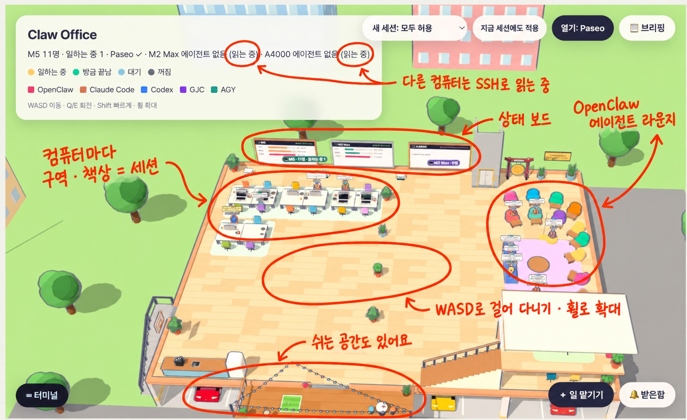
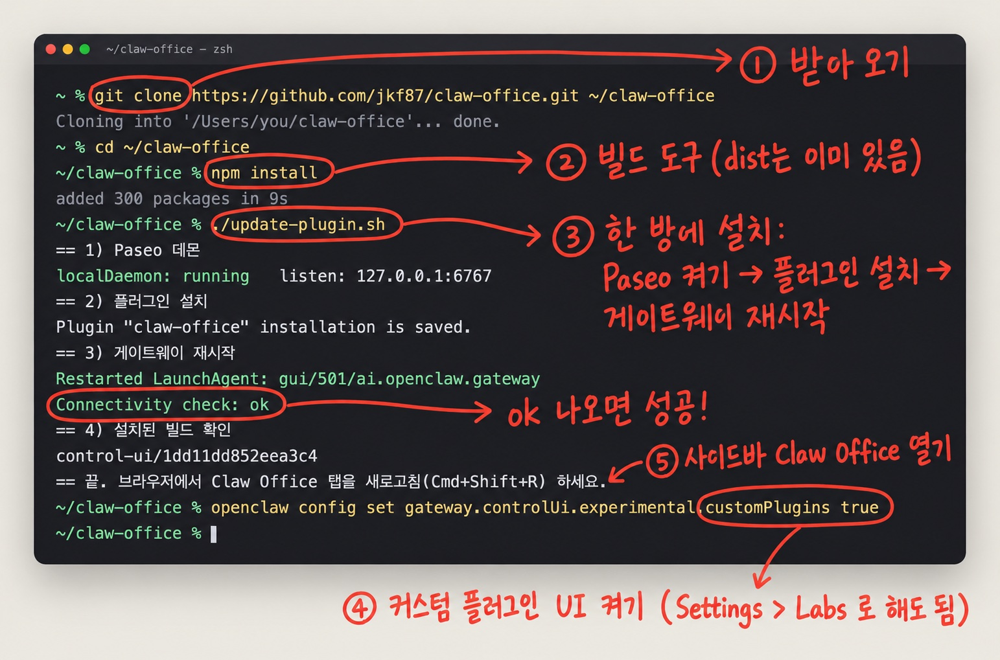
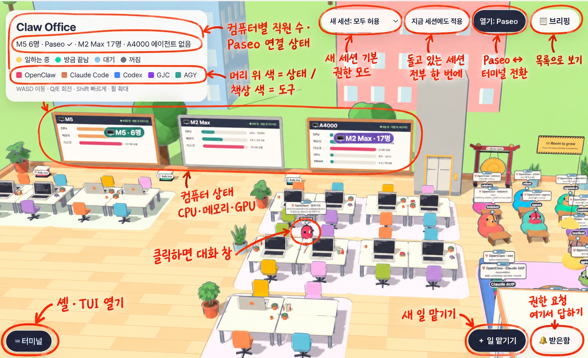

# Claw Office

OpenClaw Control UI 안에서 돌아가는 **3D 사무실**입니다. 내 컴퓨터들에서 돌고 있는 에이전트(OpenClaw 에이전트, Claude Code, Codex, AGY, GJC 세션)가 책상에 앉은 직원으로 보입니다. 클릭 한 번으로 일을 맡기고, 권한 요청에 답하고, 대화를 이어 갈 수 있습니다.

Claude Code·Codex 세션은 [Paseo](https://paseo.sh)를 통해 다룹니다. Paseo가 세션 프로세스를 직접 실행하기 때문에, 오피스에서 보낸 메시지가 **지금 돌고 있는 그 세션**에 들어갑니다. `claude --resume`으로 두 번째 프로세스를 띄우지 않으므로 대화가 갈라지지 않습니다. 권한 요청도 데이터로 받아서 버튼으로 답합니다.



## 할 수 있는 것

| 기능 | 어디서 |
|---|---|
| 컴퓨터별 에이전트·세션을 직원으로 보기 (일하는 중 / 방금 끝남 / 대기 / 확인 필요) | 3D 오피스, 📋 브리핑 |
| 컴퓨터 상태(CPU·메모리·디스크·GPU) 보기 | 북쪽 벽 보드 |
| OpenClaw 에이전트에게 새 세션으로 일 맡기기 | ＋ 일 맡기기 |
| Claude Code·Codex 새 세션을 폴더 지정해서 시작하기 (Paseo) | ＋ 일 맡기기 → "Claude Code · M5 (Paseo)" |
| 세션 대화 이어 가기 — 같은 세션에 바로 입력 | 직원 클릭 → 오른쪽 대화 창 |
| 권한 요청에 답하기 (허용 / 이 세션은 편집 자동 허용 / 거부) | 🔔 받은함, 대화 창 |
| 세션 권한 모드 바꾸기 (매번 묻기 / 편집 자동 허용 / 자동 검토 / 모두 허용 / 계획만) | 대화 창 상단 "모드:" |
| 새 세션 기본 모드 정하기, 지금 세션 전부에 한 번에 적용 | 오른쪽 위 "새 세션: …", "지금 세션에도 적용" |
| 터미널에서만 돌던 세션을 Paseo로 가져오기 | 기록에만 있는 세션 클릭 (기본값) |
| 세션을 터미널(PTY)에서 열기 | 오른쪽 위 "열기: Paseo" → "열기: 터미널" |
| OpenClaw 에이전트 TUI, 셸 열기 | ⌨ 터미널 |

세션은 웹 대시보드의 채팅 화면으로 넘어가지 않고, 항상 Paseo 대화 창이나 옆 터미널 패널에서 열립니다. 대화 창은 폰 화면 폭에서도 전체 화면으로 열리고, 한글은 일반 입력창으로 입력됩니다.

## 설치

필요한 것: OpenClaw 2026.9.8 이상, Node 24.16 이상, 그리고 각 컴퓨터에 로그인된 `claude`(와 `codex`).



```sh
git clone https://github.com/jkf87/claw-office.git ~/claw-office
cd ~/claw-office
npm install            # 빌드할 때만 필요 (dist/는 커밋돼 있음)
./update-plugin.sh     # Paseo 데몬 켜기 → 플러그인 설치 → 게이트웨이 재시작
```

그다음 Control UI에서 **Settings > Labs > Custom plugin UI**를 켜고(터미널이면 `openclaw config set gateway.controlUi.experimental.customPlugins true`), 사이드바의 **Claw Office**를 엽니다.

`update-plugin.sh`는 실행 결과를 `.update.log`에 남깁니다. 손으로 할 때는 이렇게 합니다.

```sh
npm install -g @getpaseo/cli && paseo daemon start
openclaw plugins install . --force --accept-capabilities
openclaw gateway restart
```

플러그인을 실행 중인 게이트웨이에 핫리로드하면 교체가 멈출 수 있습니다. 업데이트할 때는 게이트웨이를 재시작하는 쪽이 확실합니다.

## Paseo 연결

게이트웨이가 있는 컴퓨터의 `~/.claw-office/paseo.json`에 데몬 목록을 적습니다. 파일이 없으면 이 컴퓨터의 데몬(`ws://127.0.0.1:6767/ws`)만 씁니다. 예시는 [`paseo.example.json`](paseo.example.json)에 있습니다.

```json
{ "hosts": [
  { "id": "m5", "label": "M5", "url": "ws://127.0.0.1:6767/ws" },
  { "id": "m2max", "label": "M2 Max", "url": "ws://<tailscale-ip>:6767/ws", "password": "<데몬 비밀번호>" }
] }
```

- `id`는 그 컴퓨터의 에이전트가 앉을 사무실 구역입니다(`m5`, `m2max`, `a4000`).
- 다른 컴퓨터의 데몬은 `~/.paseo/config.json`의 `daemon.listen`을 Tailscale 주소로 바꾸고 비밀번호를 설정해야 연결할 수 있습니다([Paseo 연결 문서](https://paseo.sh/docs/connectivity)).
- 폰에서는 Paseo 앱으로도 같은 세션을 볼 수 있습니다(`paseo daemon pair`).

**주의:** Paseo로 가져온 세션을 터미널에서 따로 `claude --resume` 하지 마세요. 같은 대화를 두 프로세스가 이어 쓰게 됩니다. 다른 터미널에서 아직 일하는 중인 세션은 오피스가 가져오지 않고 안내만 띄웁니다.

## 사용법

### 둘러보기



- 사이드바에서 **Claw Office**를 열면 컴퓨터마다 구역이 나뉜 사무실이 뜹니다. 직원 머리 위 색이 상태입니다: 노랑 일하는 중, 초록 방금 끝남, 하늘 대기, 회색 꺼짐. 책상 색은 도구입니다(OpenClaw·Claude Code·Codex·GJC·AGY).
- 이동은 WASD, 회전은 Q/E, Shift로 빠르게, 마우스 휠로 확대합니다.
- **📋 브리핑**을 누르면 지금 세션을 목록으로 봅니다. 3D가 무거운 폰에서는 이쪽이 편합니다.
- 북쪽 벽 보드에 컴퓨터별 CPU·메모리·디스크·GPU가 뜹니다.

### 일 맡기기

1. **＋ 일 맡기기**를 누릅니다.
2. **누구에게**를 고릅니다.
   - OpenClaw 에이전트: 새 세션으로 일을 보냅니다.
   - "Claude Code · M5 (Paseo)" 같은 항목: **어느 폴더에서**에 절대 경로를 적으면 그 컴퓨터의 그 폴더에서 새 세션이 뜹니다. 권한 모드는 오른쪽 위 **새 세션:** 값으로 시작합니다(기본 자동 검토).
3. **무엇을**과 **끝나면 남아 있어야 할 것**을 적고 보냅니다. 새 직원이 책상에 앉고, 클릭하면 대화 창이 열립니다.

### 세션 이어 가기

- 직원이나 브리핑 줄을 클릭하면 오른쪽에 **대화 창**이 열립니다. 아래 입력창에 적으면 지금 돌고 있는 그 세션에 바로 들어갑니다.
- 터미널에서만 돌던(로그에만 있는) 세션은 클릭하는 순간 Paseo로 가져와서 엽니다. 다른 터미널에서 아직 쓰는 중이면 가져오지 않고 알려 줍니다.
- Paseo 대신 터미널로 열고 싶으면 오른쪽 위 **열기: Paseo**를 눌러 **열기: 터미널**로 바꿉니다. 이 브라우저에 기억됩니다. Paseo가 이미 맡은 세션은 늘 대화 창으로 열립니다.
- OpenClaw 에이전트 TUI나 셸은 **⌨ 터미널**에서 엽니다.

### 권한 요청 답하기

- 세션이 도구 허락을 기다리면 직원이 "확인 필요"로 바뀌고 **🔔 받은함**에 카드가 쌓입니다.
- 카드나 대화 창에서 **허용 / 이 세션은 편집 자동 허용 / 거부** 중 하나를 누릅니다.

### 권한 모드 바꾸기

| 모드 | 하는 일 |
|---|---|
| 매번 묻기 | 도구를 처음 쓸 때마다 허락을 받습니다 |
| 편집 자동 허용 | 파일 수정은 묻지 않고, 명령 실행 등은 묻습니다 |
| 자동 검토 | 분류 모델이 보고 안전한 요청은 알아서 허용합니다 |
| 모두 허용 | 아무것도 묻지 않습니다 (믿는 폴더에서만) |
| 계획만 | 읽고 계획만 세우고, 실행·수정은 하지 않습니다 |

- 한 세션만: 대화 창 위 **모드:**에서 고릅니다. 다음 도구 호출부터 적용됩니다.
- 새 세션 기본값: 오른쪽 위 **새 세션:**에서 고릅니다(브라우저마다 기억).
- 지금 세션 전부: 그 옆 **지금 세션에도 적용**을 누르면 연결된 모든 컴퓨터의 Claude Code 세션이 같은 모드로 바뀝니다. "모두 허용"은 한 번 더 눌러야 적용됩니다. Codex 세션은 자기 기본값을 그대로 씁니다.

## 내 컴퓨터 구성에 맞추기

컴퓨터 목록은 지금 코드에 들어 있습니다(M5 · M2 Max · A4000). 다른 구성에서 쓰려면 아래 세 곳을 고치고 `npm run build` → `./update-plugin.sh` 합니다.

| 파일 | 고칠 것 |
|---|---|
| `src/machines.ts`의 `MACHINES` | 세션 로그를 SSH로 읽을 다른 컴퓨터. `ssh`는 `~/.ssh/config`의 Host 이름, Node가 없으면 `probeOnly: true` |
| `src/stats.ts`의 `SOURCES` | 상태 보드에 띄울 컴퓨터. 맥은 `readMac("<ssh 호스트>")`, 윈도는 `readWindows("<ssh 호스트>")` |
| `src/control-ui.ts`의 `HOME` | 게이트웨이가 도는 이 컴퓨터의 구역 id·이름 |

`~/.claw-office/paseo.json`의 `id`를 위 id와 맞추면 Paseo 세션과 로그 세션이 같은 구역에 앉습니다.

## 개발

```sh
npm run build       # dist/ 와 openclaw.plugin.json 의 controlUi 경로를 다시 만듦
npm run typecheck   # 지금 기존 오류 32개 (vendor/ 26개, src/paseo.ts 6개)
npm run validate
```

| 파일 | 역할 |
|---|---|
| `src/index.ts` | 게이트웨이 쪽 진입점. feature contract 핸들러와 언로드 시 정리 서비스 |
| `src/contract.ts` | 브라우저↔게이트웨이 작업 정의 (세션 목록, Paseo 조작 등) |
| `src/paseo.ts` | 컴퓨터별 Paseo 데몬 연결, 에이전트·권한·타임라인 읽기와 조작 |
| `src/scan.ts`, `src/machines.ts`, `src/remote.ts` | Claude Code·Codex 세션 로그 읽기 (이 컴퓨터는 직접, 다른 컴퓨터는 SSH) |
| `src/stats.ts` | 컴퓨터 상태 보드 |
| `src/control-ui.ts` | 페이지: 직원 배치, 클릭 동작, 상단 버튼 |
| `src/chat.ts` | Paseo 대화 창 (타임라인, 권한 카드, 입력, 모드) |
| `src/desk.ts` | 일 맡기기 창, 🔔 받은함 |
| `src/term.ts` | 터미널 패널 (게이트웨이 PTY) |
| `src/modes.ts` | 권한 모드 이름과 새 세션 기본값 |
| `src/office/` | 3D 장면, 평면도, 보드 |

브라우저 코드는 SDK의 `control-ui`, `feature-contract` 진입점만 import합니다. Paseo 클라이언트 같은 의존성은 `dist/`에 번들되므로 `devDependencies`에 둡니다. OpenClaw 2026.10 이후는 `dependencies`에 있는 패키지가 `node_modules`에 없으면 플러그인을 켜지 않습니다.

## 기여하기

버그 제보·제안·PR 환영합니다. 개발 환경, 지킬 것, PR 전 확인 사항은 [CONTRIBUTING.md](CONTRIBUTING.md)에 있습니다.

## 라이선스

Claw Office 코드는 [MIT 라이선스](LICENSE)입니다. 3D 사무실·직원·모델은 [Agent Office](https://github.com/AgentSystemLabs/agent-office)(MIT, © 2026 AgentSystemLabs)의 것이며, `vendor/agent-office/`에 수정 없이 들어 있습니다. 자세한 내용은 [NOTICE.md](NOTICE.md)를 보세요.
